  

# 🚀 Awesome AI System Design & Architecture Agents

> 🧠 A curated directory and comprehensive ecosystem guide of **AI System Design & Architecture Agents**, Diagram-as-Code engines, visual cloud topology compilers, and automated software architecture modeling tools.

  
  
  
  
  
  
  

---

## 📖 Overview

Modern software engineering is transitioning from manual, static whiteboard diagrams to **AI-driven architecture synthesis** and **Diagram-as-Code (DaC)**. This repository tracks production **SaaS platforms**, enterprise visual workspaces, and **open-source developer tools** that empower Principal Architects, Staff Engineers, Tech Leads, and autonomous AI agents to:

- 📝 Transform natural language user stories, RFCs, and PRDs into comprehensive C4 models, sequence diagrams, and ERDs.
- ☁️ Reverse-engineer live git codebases and Terraform/OpenTofu configurations into interactive cloud topologies.
- 📐 Generate version-controlled, auditable architecture specifications using Mermaid, PlantUML, D2, and Structurizr DSL.
- 🔌 Integrate Diagram-as-Code MCP (Model Context Protocol) servers directly into autonomous coding agents (Claude Code, Cursor, Copilot Workspace).

---

## 📑 Table of Contents

- [📊 Sector Overview & Market Dynamics](#-sector-overview--market-dynamics)
- [🏢 SaaS & Hosted Platforms](#-saas--hosted-platforms)
- [💻 Open-Source GitHub Projects](#-open-source-github-projects)
- [🛡️ Architecture Decision Records & Linters](#️-architecture-decision-records--linters)
- [⭐ Star History](#-star-history)
- [💖 Support](#-support)
- [🤝 Contributing](#-contributing)
- [📜 License & Disclaimer](#-license--disclaimer)

---

## 📊 Sector Overview & Market Dynamics

The global diagramming and visual architecture software market is valued at approximately **$1.8B to $2.5B** (projected to reach **$6.8B+ by 2030** at ~10% CAGR). The sector is **moderately fragmented**: horizontal enterprise collaboration giants (Datadog, Miro, Lucid Software) capture significant enterprise spend, but developer-first adoption remains heavily decentralized across specialized Diagram-as-Code tools, open-source engines, and emerging AI-native architecture startups.

---

## 🏢 SaaS & Hosted Platforms

| Product | Valuation / Revenue | Starting Pricing | Free Tier Limits | Key Architecture Features |
| :--- | :--- | :--- | :--- | :--- |
| **[Cloudcraft](https://cloudcraft.co)** | ~$60B Public Market Cap *(Datadog NASDAQ: DDOG)* | $15 / host / month *(via Datadog Pro)* | Free with any Datadog plan (Datadog free tier covers up to 5 hosts with 1-day metric retention; standalone cloudcraft provides limited trial) | Isometric 3D/2D live AWS & Azure architecture diagrams with real-time billing cost forecasting and telemetry overlays. |
| **[Lucidchart AI](https://lucidchart.com)** | ~$3.0B Valuation *(~$140M+ ARR)* | $9.00 / user / month *(billed annually)* | Free forever: 3 editable documents, max 75 shapes/objects per document, basic Lucid AI access | Enterprise diagramming suite with AI-assisted prompt-to-flowchart synthesis, cloud infrastructure imports (AWS/Azure/GCP), and Confluence/Jira integration. |
| **[Miro AI](https://miro.com)** | ~$1.36B Valuation *(~$600M ARR)* | $8.00 / member / month *(billed annually)* | Free forever: 3 active editable boards, unlimited viewers, basic AI credits (~10/team/month), shared workspace only | Enterprise collaborative canvas with Miro AI text-to-diagram generators, cloud topology templates, and interactive architecture review rooms. |
| **[Eraser.io](https://eraser.io)** | ~$4M Funding *(~$2.8M ARR)* | $45.00 / member / month *(billed annually)* | Free forever: 3 files max, 3 AI DiagramGPT credits / month, 7-day version history, unlimited viewers | Developer-first documentation canvas pairing Markdown notes with DiagramGPT to synthesize C4 architecture, ERDs, and cloud topologies from code. |
| **[Brainboard](https://brainboard.co)** | ~$2.5M Valuation *(~$1.5M ARR)* | $99.00 / user / month *(Starter Plan)* | Free forever: 1 workspace, unlimited cloud architecture diagrams, unlimited Terraform/OpenTofu code exports | Visual cloud architecture workspace that automatically translates drag-and-drop cloud topologies into production Terraform code with built-in CI/CD. |
| **[IcePanel](https://icepanel.io)** | ~$500K Funding *(Seed / YC)* | $40.00 / editor / month *(billed annually)* | Free forever: 1 editor, up to 100 model objects, 2 tag groups, 1 interactive flow per diagram, unlimited viewers | Interactive C4 model diagramming tool connecting zoomable domain contexts to code repositories, API contracts, and Architecture Decision Records (ADRs). |
| **[Visual Paradigm Online](https://visual-paradigm.com)** | Bootstrapped / Private *(Est. $10M–$25M Revenue)* | $4.00 / user / month *(Starter Plan)* | Free forever (personal/non-commercial): 1 GB cloud storage, basic web diagrams, smartboards, and VPasCode access | UML, BPMN, ArchiMate, and ERD system-modeling suite with AI-driven diagram generation and enterprise software architecture documentation tools. |
| **[Structurizr](https://structurizr.com)** | Bootstrapped / Independent *(Est. ~$500K ARR)* | £300 / month *(Self-hosted team license, 1–20 users)* | Free forever: Structurizr DSL is 100% free; web browser sandbox available at `playground.structurizr.com` (Cloud SaaS retired Sept 2026) | Flagship C4 model-as-code solution by Simon Brown, creating consistent System Context, Container, Component, and Code diagrams from single DSL scripts. |
| **[Draw.io Cloud](https://diagrams.net)** | Bootstrapped / Private *(JGraph Ltd)* | $15.00 / month *(Atlassian Marketplace 20-user tier)* | Free forever: `app.diagrams.net` is 100% free with unlimited diagrams and no login; Atlassian Cloud plugin is free up to 10 users | Privacy-first diagramming suite with zero server-side storage, full cloud-storage integration (Google Drive, GitHub), and AI diagram generators. |
| **[Kroki Hosted](https://kroki.io)** | Open-Source / Sponsored Infrastructure | Free / Donation Supported | Free forever: Public web API at `kroki.io` is unmetered for standard interactive use; no credit card required | Multi-engine diagram conversion API service rendering PlantUML, Mermaid, D2, Graphviz, Structurizr, and BPMN into SVG/PNG/PDF on demand. |

---

## 💻 Open-Source GitHub Projects

Curated open-source repositories for AI system design, Diagram-as-Code engines, and visual architecture toolkits—ranked by GitHub community stargazers.

| Project & Repo Link | GitHub_Stars | License | Description & Architectural Focus |
| :--- | :--- | :--- | :--- |
| **[Excalidraw](https://github.com/excalidraw/excalidraw)** |  | `MIT` | Virtual hand-drawn collaborative whiteboard with AI text-to-diagram synthesis, Mermaid import, and end-to-end encrypted live rooms. |
| **[Mermaid](https://github.com/mermaid-js/mermaid)** |  | `MIT` | The ubiquitous Markdown-inspired diagram syntax natively supported by GitHub, GitLab, Notion, and AI LLM chat interfaces for flowcharts and C4 diagrams. |
| **[AFFiNE](https://github.com/toeverything/AFFiNE)** |  | `MIT` | Hyper-converged knowledge base uniting structured Markdown architecture specs, edgeless system design whiteboards, and AI canvas blocks. |
| **[Draw.io Desktop](https://github.com/jgraph/drawio-desktop)** |  | `Apache-2.0` | Cross-platform offline desktop application for diagrams.net with extensive cloud architecture stencils (AWS, GCP, Azure, Kubernetes). |
| **[tldraw](https://github.com/tldraw/tldraw)** |  | `tldraw` | Infinite canvas SDK and collaborative vector whiteboard powering custom AI diagramming interfaces and Make-Real prototyping agents. |
| **[Diagrams](https://github.com/mingrammer/diagrams)** |  | `MIT` | Diagram-as-Code Python framework enabling engineers and autonomous code agents to declare AWS, GCP, Azure, and K8s topologies in pure Python. |
| **[xyflow / React Flow](https://github.com/xyflow/xyflow)** |  | `MIT` | Highly customizable node-based UI library in React/Svelte powering interactive AI workflow visualizers, system architecture tools, and pipeline builders. |
| **[Next AI Draw.io](https://github.com/DayuanJiang/next-ai-draw-io)** |  | `Apache-2.0` | Open-source web application pairing LLMs with Draw.io XML generation to construct and refine complex system architecture diagrams via natural language. |
| **[D2](https://github.com/terrastruct/d2)** |  | `MPL-2.0` | Modern declarative diagramming language in Go featuring auto-layout engines (ELK/Tala), interactive drill-downs, and human/LLM-friendly syntax. |
| **[PlantUML](https://github.com/plantuml/plantuml)** |  | `GPL-3.0` | Veteran text-to-diagram engine converting human-readable plain text into UML sequence diagrams, class models, and C4-PlantUML architectures. |
| **[bpmn-js](https://github.com/bpmn-io/bpmn-js)** |  | `Camunda License` | Industry-standard BPMN 2.0 diagram rendering and web modeling toolkit for business process workflows and choreography specs. |
| **[Draw.io Web Core](https://github.com/jgraph/drawio)** |  | `Apache-2.0` | Core web client source repository for diagrams.net diagramming editor and browser engine. |
| **[Dependency Cruiser](https://github.com/sverweij/dependency-cruiser)** |  | `MIT` | Validates, visualizes, and enforces module dependency rules across JavaScript/TypeScript codebases with automated Mermaid/DOT exports. |
| **[C4-PlantUML](https://github.com/plantuml-stdlib/C4-PlantUML)** |  | `MIT` | Standard PlantUML macro library implementing the C4 model for visual software architecture documentation. |
| **[Mermaid Live Editor](https://github.com/mermaid-js/mermaid-live-editor)** |  | `MIT` | Interactive web playground for authoring, previewing, and sharing Mermaid diagrams with instant SVG/PNG exports. |
| **[AntV X6](https://github.com/antvis/X6)** |  | `MIT` | Graph editing engine and visual modeling framework providing node/edge editing for DAG pipelines, ER models, and system canvases. |
| **[LikeC4](https://github.com/likec4/likec4)** |  | `MIT` | Architecture-as-Code tooling language with live React/Vite previews, automated multi-level drilldown views, and CLI code generation. |
| **[Kroki](https://github.com/yuzutech/kroki)** |  | `MIT` | Unified diagram generation gateway and microservice converting 25+ Diagram-as-Code formats from a single Docker container. |
| **[ArchUnit](https://github.com/TNG/ArchUnit)** |  | `Apache-2.0` | Architectural test library for Java verifying package dependencies, cyclic checks, and layered architecture boundaries in unit tests. |
| **[Blast Radius](https://github.com/28mm/blast-radius)** |  | `MIT` | Interactive computation and visual dependency tool for Terraform graph models using d3.js. |
| **[InfraMap](https://github.com/cycloidio/inframap)** |  | `GPL-3.0` | CLI utility that reads Terraform state or HCL files and prints clean, consolidated cloud infrastructure diagrams. |
| **[Terravision](https://github.com/patrickchugh/terravision)** |  | `GPL-3.0` | CLI tool parsing Terraform code to generate visual architecture diagrams across AWS, Google Cloud, and Azure. |
| **[Pluralith CLI](https://github.com/pluralith/pluralith-cli)** |  | `AGPL-3.0` | Automated infrastructure documentation CLI generating dynamic state diagrams directly from Terraform runs. |
| **[LangChain Design Agent](https://github.com/langchain-ai/design-agent)** |  | `MIT` | AI software architecture and system-design assistant built with LangGraph exploring trade-offs and outputting structured architecture plans. |
| **[Structurizr CLI](https://github.com/structurizr/cli)** |  | `Apache-2.0` | Command-line utility to validate, build, and export Structurizr DSL architecture models to PlantUML, Mermaid, and D2. |

---

## 🛡️ Architecture Decision Records & Linters

Maintain architectural integrity by pairing your diagrams with git-versioned Architecture Decision Records (ADRs):

- 📜 **[ADR Tools (`npryce/adr-tools`)](https://github.com/npryce/adr-tools)** : CLI for managing lightweight architecture decision records within a repository.
- 📚 **[Log4brains (`thomvaill/log4brains`)](https://github.com/thomvaill/log4brains)** : Architecture knowledge-base and static site generator documenting ADRs right next to code.
- 🔌 **[Diagram-as-Code MCP Servers](https://modelcontextprotocol.io)**: Connect AI agents directly to local Mermaid, D2, and Graphviz renderers via Model Context Protocol.

---

## ⭐ Star History

---

## 💖 Support

Thank you for visiting and using this ecosystem guide! If you find this curated collection helpful for your system design and engineering workflows:

- ⭐ **Star** this repository to help others discover it!
- 🍴 **Fork** and contribute your favorite architecture agents and diagramming tools.
- 📢 **Share** it with your engineering peers, technical architects, and DevOps teams.
- ☕ **Buy a coffee & sponsor** the continuous curation and maintenance on the [GitHub Sponsors Dashboard](https://github.com/sponsors/ishandutta2007).

---

## 🤝 Contributing

Contributions are very welcome! Whether you are an author of a system design tool, an open-source maintainer, or an architect with battle-tested recommendations:

1. 🍴 Fork this repository.
2. 🔍 Check existing entries to ensure no duplicates.
3. ➕ Add your SaaS or Open-Source project in the appropriate table, adhering to the column formatting and specific pricing/limit guidelines.
4. 🚀 Submit a Pull Request with a clear summary of what you added and why it benefits software architects.

---

## 📜 License & Disclaimer

- ⚖️ Distributed under the [MIT License](LICENSE).
- ℹ️ *Disclaimer: Product names, logos, and brands referenced are property of their respective owners. Mention of SaaS platforms or commercial software does not imply formal endorsement.*
